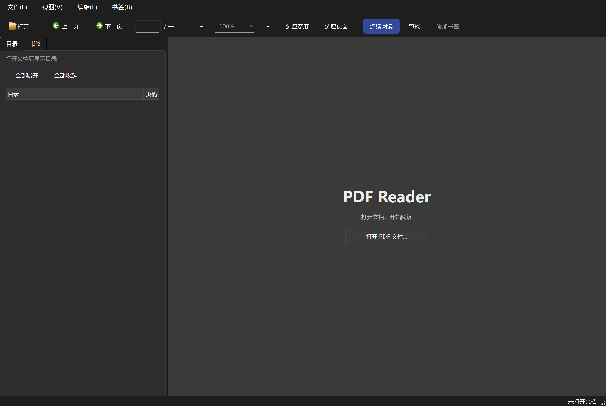

# PDF Reader

一个支持高清阅读、自动目录和个人书签的 Windows PDF 阅读器，使用 C++17、Qt 6 和 PDFium 开发。

**[下载 Windows 一键安装包](https://github.com/TheGadflyAndMontalleni/pdfreader/releases/latest/download/PDFReader-Setup.exe)** · [下载免安装版](https://github.com/TheGadflyAndMontalleni/pdfreader/releases/latest/download/PDFReader-Portable.exe) · [所有版本](https://github.com/TheGadflyAndMontalleni/pdfreader/releases)

适用于 Windows 10 / 11 的 64 位 x64 电脑。安装包已包含 Qt、PDFium 等运行组件。



## 下载与安装

1. 点击上方的 **Windows 一键安装包**，下载 `PDFReader-Setup.exe`。
2. 双击安装包，点击 **一键安装**。
3. 安装完成后阅读器会自动打开；以后使用桌面或开始菜单中的 **PDF Reader** 快捷方式。

安装面向当前用户，不需要管理员权限。程序安装到 `%LOCALAPPDATA%\Programs\PDFReader`，并加入 PDF 文件的“打开方式”和 Windows 默认应用列表。覆盖运行新版安装包即可升级，阅读记录和个人书签会保留。

需要设为默认阅读器时，在 Windows **设置 → 应用 → 默认应用** 中选择 PDF Reader。Windows 要求用户亲自确认默认应用选择。

卸载：在 Windows **设置 → 应用 → 已安装的应用** 中找到 **PDF Reader**，点击卸载。个人阅读记录和书签会保留。

### 免安装版

下载 `PDFReader-Portable.exe` 后双击运行。首次会把运行组件释放到 `%LOCALAPPDATA%\PDFReader`，以后直接启动；阅读记录和书签保存在当前电脑的用户设置中。

### 下载校验

每个 Release 都提供 [SHA256SUMS.txt](https://github.com/TheGadflyAndMontalleni/pdfreader/releases/latest/download/SHA256SUMS.txt)。在 PowerShell 中计算下载文件的 SHA-256，与该文件中的值核对：

```powershell
Get-FileHash .\PDFReader-Setup.exe -Algorithm SHA256
```

当前安装包尚未代码签名，Windows 可能显示“未知发布者”。官方安装文件通过本仓库的 Releases 分发。

## 功能

- **高清阅读**：按屏幕实际像素倍率渲染，支持 100%、150%、200% 等显示缩放；大幅放大时仅渲染可见区域。
- **快速打开**：先显示正文，再在独立进程中生成自动目录；目录按文件大小和修改时间缓存，文件变化后重建。
- **自动目录**：优先使用 PDF 内嵌大纲；没有大纲时，尝试识别印刷目录页，再从标题排版推断。侧栏支持一键全部展开或收起。
- **个人书签**：保存当前页、跳转、重命名、删除；按文档保存在本机，重启后仍可使用。
- **连续或单页阅读**：适应宽度、适应页面、页码输入、缩放输入、夜间反色。
- **选择和查找**：跨页文字选择、复制、全文查找与命中高亮。
- **多标签与阅读记录**：独立保存各文档的位置和阅读模式，恢复上次标签和最近文件。
- **标注与打印**：高亮、下划线、删除线、撤销、另存为，以及打印或保留文字层的 PDF 页范围导出。

| 操作 | 快捷键 |
| --- | --- |
| 打开 PDF / 添加当前页书签 | Ctrl+O / Ctrl+D |
| 查找 / 下一个匹配 | Ctrl+F / F3 |
| 跳转到页 | Ctrl+G |
| 放大 / 缩小 | Ctrl++ / Ctrl+-，或 Ctrl+滚轮 |
| 适应宽度 / 页面 | Ctrl+0 / Ctrl+1 |
| 上一页 / 下一页 | PageUp / PageDown |
| 关闭标签 / 恢复关闭的文件 | Ctrl+W / Ctrl+Shift+T |
| 复制 / 全选 / 打印 | Ctrl+C / Ctrl+A / Ctrl+P |
| 高亮 / 下划线 / 撤销 | Ctrl+H / Ctrl+U / Ctrl+Z |
| 反色 | I |

书签位于左侧“书签”标签，目录操作位于“目录”标签上方。

## 0.2.0 更新

修复高分屏文字发虚、拖动标签后文档错位和多文档阅读状态串档；移除缩略图与后台任务，加入个人书签、目录展开/收起和完整安装程序。

本机 61 页样本的打开文件调用约从 248 ms 降至 25 ms，200% 屏幕倍率下首屏约 65 ms。计时不包含进程冷启动和免安装版首次释放组件的时间。详见 [发布说明](docs/release-0.2.0.md)。

## 从源码构建

开发者需准备以下工具；普通用户使用上方安装包即可。

| 依赖 | 版本 | 目录 |
| --- | --- | --- |
| MinGW-w64 | GCC 13.1.0，POSIX 线程版 | `tools/Tools/mingw1310_64/` |
| Qt 动态库与开发文件 | 6.8.3，win64_mingw | `tools/`，含 `bin/`、`lib/cmake/`、`sbom/` |
| PDFium 预编译包 | chromium/8100 | `tools/pdfium/`，含 `include/`、`lib/`、`bin/`、`licenses/` |
| Python、CMake、Ninja | CMake 3.20+ | `.venv/Scripts/` |
| PowerShell | 7+ | `pwsh` |
| Inno Setup（生成安装包） | 6.7+ | 用 `-InnoCompiler` 指定 `ISCC.exe` |

下载来源：[Qt](https://download.qt.io/archive/qt/6.8/6.8.3/)、[PDFium](https://github.com/bblanchon/pdfium-binaries/releases/tag/chromium%2F8100)、[MinGW-w64](https://www.mingw-w64.org/)、[Inno Setup](https://jrsoftware.org/isdl.php)。打包时使用 Qt 安装目录中的 `sbom/qtbase-6.8.3.spdx` 提供第三方版权信息。

```powershell
python -m venv .venv
.venv\Scripts\pip install cmake ninja
pwsh -NoProfile -File tools/make_pdfium_implib.ps1
pwsh -NoProfile -File tools/build.ps1
.\build\pdfreader.exe "C:\path\to\document.pdf"
```

### 生成发布文件

```powershell
pwsh -NoProfile -File tools/make_release.ps1 `
  -InnoCompiler "C:\Program Files (x86)\Inno Setup 6\ISCC.exe"
```

生成 `dist/PDFReader-Setup.exe`、`dist/PDFReader-Portable.exe` 和 `dist/SHA256SUMS.txt`。二进制通过 GitHub Release 附件分发。已有构建可加 `-SkipBuild`，也可分别运行 `tools/make_installer.ps1` 和 `tools/make_sfx.ps1`。

### 验证

```powershell
pwsh -NoProfile -File tools/verify.ps1 -Corpus "C:\path\to\pdf-corpus"
pwsh -NoProfile -File tools/verify_installer.ps1 `
  -Pdf "C:\path\to\quality2020.pdf"
```

验证使用独立设置文件；安装器验证另外编译测试身份的安装包，将注册项和快捷方式隔离到测试位置。回归样本需要有文字、可用目录和足够页面；默认语料中的 `quality2020.pdf` 用于自动目录、跨页导航和标注检查。

## 代码结构

- `src/doc.*`、`text.*`、`render.*`：PDF 生命周期、文字抽取、高清与裁剪渲染。
- `src/toc.*`、`printed_toc.cpp`、`toc_typography.cpp`：内嵌大纲、印刷目录和排版推断。
- `src/app/`：Qt 界面、书签、会话、打印与独立目录进程。
- `tools/installer/`：Windows 安装程序；`tools/stage_runtime.ps1` 统一准备运行库与许可证。
- `tests/`：PDFium 探针、目录检查和阅读器回归。

## 当前限制

- 扫描 PDF 的图片清晰度取决于文件本身，目前不提供 OCR。
- 自动目录使用启发式识别，复杂排版、表格和没有文字层的文件可能无法生成准确目录。
- 标注烘焙进页面，不是其他阅读器中可独立编辑的交互式注释。
- 实体打印机使用光栅打印；导出 PDF 页范围保留文字层。
- 当前提供 Windows x64 版本。

## 许可证

本项目使用 [MIT License](LICENSE)。Qt 使用动态链接，第三方许可证与来源见 [THIRD_PARTY_NOTICES.md](THIRD_PARTY_NOTICES.md)。安装版和免安装版均包含相应许可文件。
