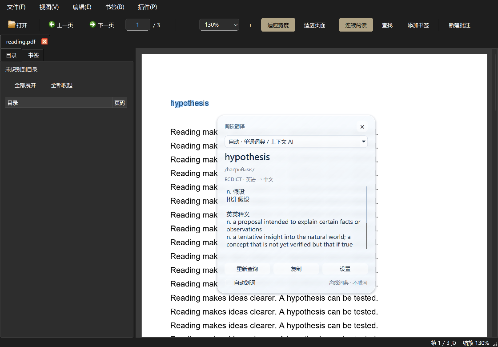

# 词典与 DeepSeek 阅读翻译 1.1.0

选中文字后按 **Alt+T**：单个英文词查完整词典释义，短语或长上下文交给 DeepSeek 翻译、解释语境。毛玻璃卡片优先出现在选区右下方，避开原文。



## 安装与升级

1. 建议先安装 [PDF Reader 0.4.1](https://github.com/TheGadflyAndMontalleni/pdfreader/releases/tag/v0.4.1)，以获得准确的选区坐标和随阅读位置更新的浮窗。
2. [下载插件包](https://github.com/TheGadflyAndMontalleni/pdfreader/releases/download/deepseek-translate-v1.1.0/DeepSeekTranslate-1.1.0.zip)，解压得到 `DeepSeekTranslate.dll`。
3. 在 **插件 → 插件管理 → 安装插件…** 中选择 DLL，然后启用 **DeepSeek 生词翻译**。
4. 打开 PDF，选中一个英文词，按 **Alt+T** 即可离线查词，不需要 API Key。
5. 要理解短语或长上下文，在 **插件 → DeepSeek 生词翻译 → 翻译与 DeepSeek 设置…** 中保存自己的 API Key，再选中文字并按 **Alt+T**。

**已有 1.0 版插件时**：先禁用，关闭并重新启动阅读器；在插件管理中移除旧插件，再安装 1.1。配置和加密 Key 会保留。已加载 DLL 会被 Windows 占用，单纯关闭翻译小窗不足以替换插件。也可 [直接下载 DLL](https://github.com/TheGadflyAndMontalleni/pdfreader/releases/download/deepseek-translate-v1.1.0/DeepSeekTranslate.dll)。

支持 Windows 10 / 11 x64、Qt 6.8.3、MinGW 13.1.0、Release、Plugin API 1。0.3.0 / 0.4.0 也能加载，但缺少准确选区坐标，只能按最近划词的鼠标位置估算；需要升级到 0.4.1 才能完整实现避开选区及滚动跟随。

## 三种查询方式

浮窗顶部可选择 **自动 / 离线英汉词典 / DeepSeek 语境理解**，选择会保存。

- **自动**：单个英文词使用离线词典，短语、句子、长段落或非英文内容使用 DeepSeek。
- **离线英汉词典**：内置 [ECDICT](https://github.com/skywind3000/ECDICT) 的 770,611 条词条，显示词库提供的音标、中英文完整释义和词形变化；可滚动查看和复制。查词不联网，不消耗 API 额度。词库未收录时会提示手动切换 DeepSeek。
- **DeepSeek 语境理解**：自动识别原文语言，默认给出中文翻译；对较长内容附上简短的语境、习语或论述解释。最多处理 8,000 字符，只发送当前选区，不额外读取整页或上传 PDF。

默认模型为 `deepseek-flash`，可在设置中修改。请求使用官方 `https://api.deepseek.com/chat/completions`、非思考模式和 JSON 输出，模型及费用以 [DeepSeek 官方文档](https://api-docs.deepseek.com/) 为准。AI 解释仍可能出现错误，重要内容请结合原文核对。

默认按快捷键或菜单触发。勾选 **自动划词** 后，松开鼠标、选区稳定约半秒才查询。相同模型最近 128 次成功 AI 查询在当前启用期间缓存；**重新查询** 可强制重试。

## 浮窗

圆角、柔和边框、阴影和半透明磨砂背景；背景模糊采样只来自阅读器自身，不截图其他应用，不依赖 Windows 私有材质接口。显示、滚动或移动时更新背景，兼容 Windows 10 / 11。

优先放在选区右下方；空间不足时转向上方或侧面，并限制在所在屏幕的可用区域。选区滚出视野时隐藏；周围没有足够空间容纳可读窗口时，在状态栏提示调整选区，避免覆盖选中文字。按 **Esc** 或右上角 **×** 关闭，取消尚未完成的请求。

## Key 与数据

Key 使用 Windows 当前用户的 DPAPI 加密后保存在本机配置，不以明文写入配置文件、日志或插件包。也支持 `DEEPSEEK_API_KEY` 环境变量；仅在没有可解密的已存 Key 时读取。

词典查询完全离线。DeepSeek 请求仅包含翻译指令和当前选中的文字，不发送文件名、路径、书签、批注或其他页面文字。AI 缓存只在内存中。网络使用系统代理与证书校验，不跟随重定向；请求最多等待 30 秒。更换选区、关闭浮窗、切换文档或禁用插件时取消旧请求。

## 构建与验证

使用与阅读器一致的 Qt 6.8.3 / MinGW GCC 13.1.0 / Windows x64 / Release：

```powershell
python tools/prepare_translation_dictionary.py --output build/deepseek-translate/data
pwsh -NoProfile -File tools/build_plugin.ps1 `
  -Source plugins/deepseek_translate -BuildDir build/deepseek-translate
pwsh -NoProfile -File tools/verify_translation_plugin.ps1
pwsh -NoProfile -File tools/make_translation_plugin.ps1
```

词库生成器下载固定提交的 CSV，验证 Git blob 校验值，再生成可独立解压的小块索引。运行时每次只读取目标词所在块，不扫描或载入整个词库。词库、HTTPS 组件都嵌入同一 DLL，无需额外安装数据目录或数据库运行库。生成的 28 MB 词库数据保存在被忽略的 `build/`，不提交到源码仓库；源提交、SHA-256 和许可证随插件包提供。

验证使用合成文本、虚构 Key、本机模拟 HTTP 服务和独立配置，不读取真实 PDF 或 Key。`-ProbeNetwork` 仅使用虚构 Key 检查官方 HTTPS 认证拒绝。真实 Key 的付费 AI 翻译需要自行配置后验证。

真实阅读器定位和生命周期测试（先运行 `tools/build.ps1`）：

```powershell
$env:QT_QPA_PLATFORM = 'offscreen'
build/translation_integration.exe `
  build/deepseek-translate/reader-plugins/DeepSeekTranslate.dll `
  build/audit/translation-reader.png
```

插件源码沿用仓库 MIT 许可。ECDICT 和内嵌 Qt 组件的版权与许可证见插件包的 `licenses/`。
